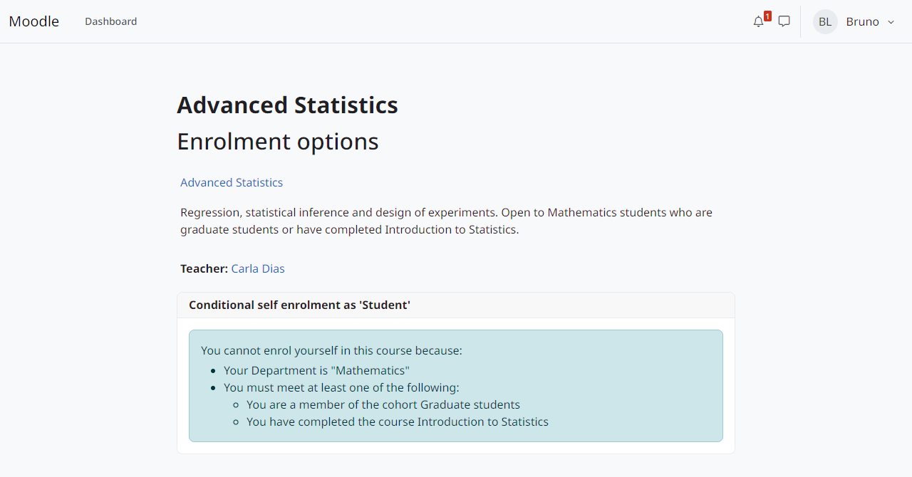
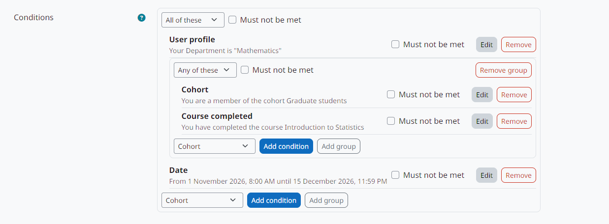

# moodle-enrol_conditional

[English](#english) · [Português (Brasil)](#português-brasil)

Documentation / Documentação: <https://moodle-by-kelsoncm.github.io/enrol_conditional/>

## English

Enrolment method based on the core self enrolment (`enrol_self`) where self enrolment depends on pluggable conditions combined with AND, OR and NOT. The conditions can also be checked again at login, periodically or when events happen, suspending or removing enrolments that no longer meet them. Supports Moodle 5.3 LTS.

Requires [`local_enrolconditions`](https://github.com/moodle-by-kelsoncm/local_enrolconditions), which provides the condition engine and the `enrolcond` subplugins (Moodle does not allow subplugins in enrolment plugins).

Install: copy `local_enrolconditions` to `public/local/enrolconditions` and this repository to `public/enrol/conditional`, then visit *Site administration > Notifications*.

Conditions included: date, profile field, cohort, completed course, typed list of usernames, file of usernames and lists defined by administrators as SQL queries. Existing enrolments can be checked again and suspended (default), removed or only logged; the plugin only reactivates the suspensions it made itself.

## Português (Brasil)

Método de inscrição baseado na autoinscrição do core (`enrol_self`) em que a autoinscrição depende de condições plugáveis combinadas com E, OU e NÃO. As condições também podem ser reavaliadas no login, periodicamente ou quando ocorrem eventos, suspendendo ou removendo inscrições que deixaram de cumpri-las. Suporta Moodle 5.3 LTS.

Requer o [`local_enrolconditions`](https://github.com/moodle-by-kelsoncm/local_enrolconditions), que fornece o motor de condições e os subplugins `enrolcond` (o Moodle não permite subplugins em plugins de inscrição).

Instalação: copie o `local_enrolconditions` para `public/local/enrolconditions` e este repositório para `public/enrol/conditional`, depois acesse *Administração do site > Notificações*.

Condições incluídas: data, campo de perfil, coorte, curso concluído, lista digitada de usernames, arquivo de usernames e listas definidas pelo administrador como consultas SQL. As inscrições existentes podem ser reavaliadas e suspensas (padrão), removidas ou só registradas; o plugin só reativa as suspensões que ele mesmo fez.

## Development / Desenvolvimento

- CI (`.github/workflows/ci.yml`) runs `moodle-plugin-ci` on Moodle 5.3 with PostgreSQL and MariaDB; run it locally with [`act`](https://github.com/nektos/act) before pushing. See [CONTRIBUTING.md](CONTRIBUTING.md).

## Support / Suporte

- Issue tracker / Rastreador de issues: <https://github.com/moodle-by-kelsoncm/enrol_conditional/issues>
- Translations / Traduções: only English is shipped; other languages go through AMOS / o pacote traz só inglês; outros idiomas via AMOS.

## License / Licença

GNU GPL v3 or later. See [LICENSE.md](LICENSE.md). Based on `enrol_self` from Moodle 5.3 (© Petr Skoda and others), also GPL v3 or later.
