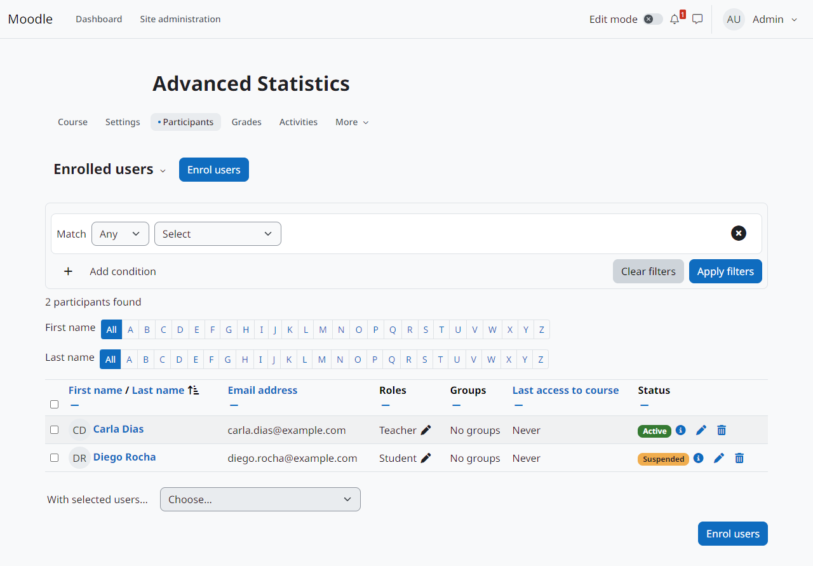

Re-checks and actions
=====================

When the conditions are checked
-------------------------------

*Check the conditions*, in each instance:

When the user enrols (always)
   Self enrolment and the web service always check the conditions.

When the user logs in
   The enrolments of the user in instances with this mode are checked at each login.

Periodically, in the scheduled task
   The task *Re-check the conditions of conditional self enrolments* checks the enrolments in batches (*Enrolments per periodic check*) and resumes where the previous run stopped.

When something the conditions depend on changes
   The enrolments are checked when an event observed by the conditions happens: profile updated (profile), cohort member added or removed (cohort), course completed (course completed). Conditions that depend only on time or on lists (date, usernames, queries) have no event: combine them with the login or periodic check.

   .. figure:: ../img/course-rechecks.png
      :alt: When the conditions are checked and what happens when they are no longer met.
      :width: 100%

      When the conditions are checked and what happens when they are no longer met.

What happens when the conditions are no longer met
--------------------------------------------------

*When the conditions are no longer met*:

Nothing (only record it)
   The plugin records the moment and fires the event *Enrolment conditions no longer met* once, when the user stops meeting the conditions, not on every check.

Suspend the enrolment (default)
   The enrolment is suspended and the event *User enrolment suspended by conditions* is fired.

Remove the enrolment
   The event *Enrolment conditions no longer met* is fired and the user is unenrolled. Course data of the user follows the site rules for unenrolment.

*Reactivate when the conditions are met again*: enrolments that this plugin suspended are reactivated when the user meets the conditions again, with the event *User enrolment reactivated by conditions*. Removing all the conditions counts as meeting them.

   A participant suspended by the conditions.

Which suspensions are reactivated
---------------------------------

The plugin only reactivates an enrolment that **it** suspended and that **nobody changed since**. It keeps its own record of each suspension (table ``enrol_conditional_state``). If a teacher, an administrator or another plugin suspends, reactivates or edits the enrolment, the record is closed and the plugin no longer touches that enrolment. A manual suspension is never undone by the conditions.

Unknown results (a condition that cannot be checked) never suspend, remove or reactivate.
