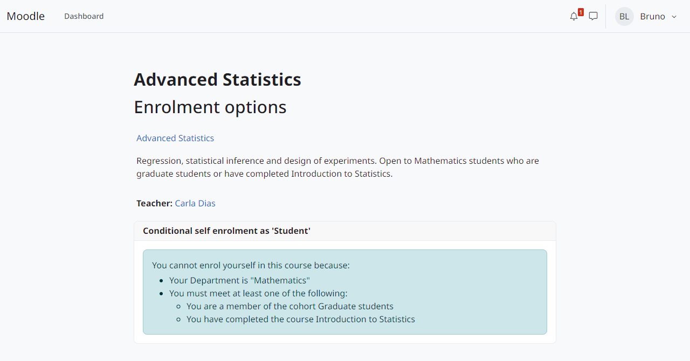

moodle-enrol_conditional
========================

**Autoinscrição que depende das condições que você escolhe: datas, campos de perfil, coortes, cursos concluídos ou listas de usernames.**

English version: `English <../en/index.html>`_.

A *Conditional self enrolment* (autoinscrição condicional) é uma cópia do método de autoinscrição do core (``enrol_self``) em que o usuário só consegue se inscrever quando cumpre as condições do método de inscrição. O professor combina as condições em grupos que exigem todos ou qualquer um dos itens, e pode inverter uma condição ou um grupo. O método também pode reavaliar as condições depois da inscrição e suspender ou remover as inscrições que deixaram de cumpri-las.

As condições vêm do plugin companheiro `local_enrolconditions <https://moodle-by-kelsoncm.github.io/local_enrolconditions/pt-br/>`_, como subplugins ``enrolcond``. Outros plugins podem acrescentar condições próprias.

   Quem não cumpre as condições vê quais faltam.

Principais recursos
-------------------

* Tudo o que o ``enrol_self`` oferece: chave de inscrição, chaves de grupo, período de inscrição, máximo de inscritos, mensagem de boas-vindas e o web service.
* Sete tipos de condição: data, campo do perfil, coorte, curso concluído, lista digitada de usernames, arquivo de usernames e listas definidas pelo administrador como consultas ao banco.
* Grupos com *Todos estes* ou *Qualquer um destes*, aninhados; cada item pode ser marcado como *Não deve ser cumprida*.
* Quem não consegue se inscrever vê quais condições não cumpre.
* Reavaliação no login, periódica ou quando muda algo de que as condições dependem, com três ações: só registrar, suspender ou remover a inscrição.
* Reativação automática que só mexe nas inscrições que o próprio plugin suspendeu, nunca numa suspensão feita por uma pessoa ou por outro plugin.
* Eventos, Privacy API e backup e restauração das condições e das suspensões do próprio plugin.

.. note:: O plugin só traz o pacote de idioma em inglês; os nomes da interface aparecem aqui em inglês, como no Moodle sem tradução.

.. toctree::
   :maxdepth: 2
   :caption: Conteúdo

   installation
   configuration
   usage
   conditions
   rechecks
   backup_privacy
