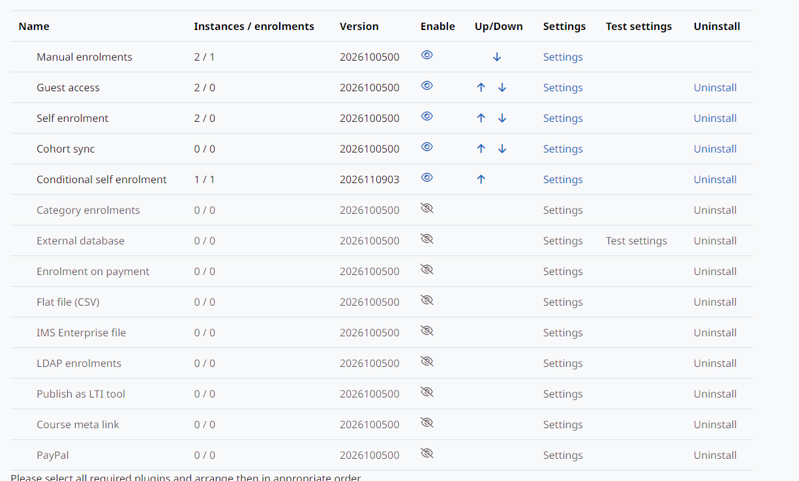

Instalação
==========

Requisitos: Moodle 5.3 LTS e `local_enrolconditions <https://github.com/moodle-by-kelsoncm/local_enrolconditions>`_, que fornece as condições (`documentação dele <https://moodle-by-kelsoncm.github.io/local_enrolconditions/pt-br/>`_).

#. Copie o ``local_enrolconditions`` para ``public/local/enrolconditions``.
#. Copie este plugin para ``public/enrol/conditional``.
#. Acesse *Administração do site > Notificações* e conclua a instalação.
#. Habilite o método em *Administração do site > Plugins > Inscrições > Gerenciar plugins de inscrição*.

   *Conditional self enrolment* habilitado em *Gerenciar plugins de inscrição*.

Cursos novos não recebem uma instância deste método por padrão. Adicione-a em cada curso em *Participantes > Métodos de inscrição*, ou ligue *Adicionar instância aos novos cursos* nas configurações do plugin.
