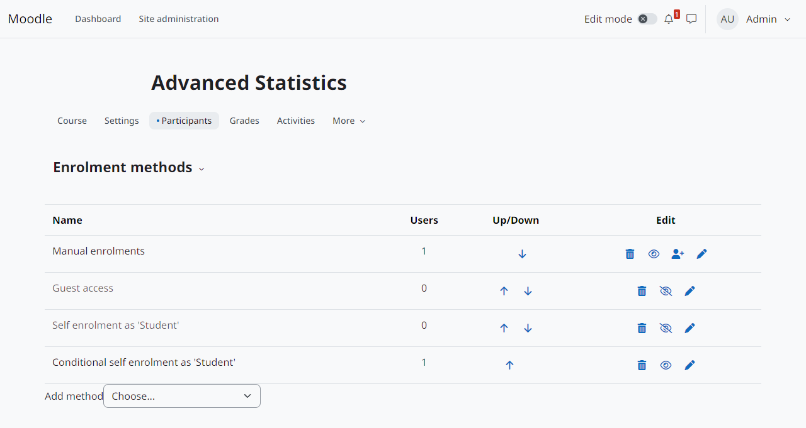
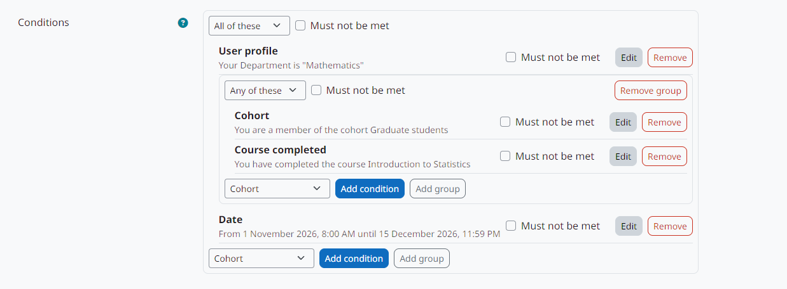
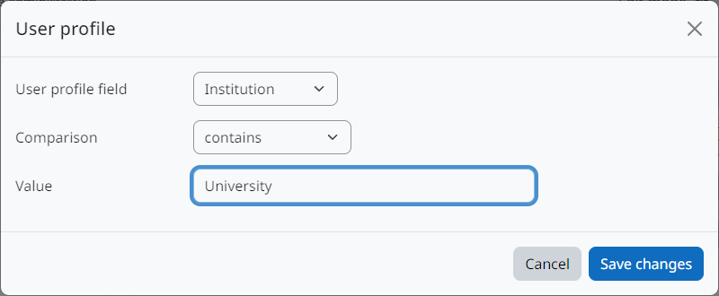
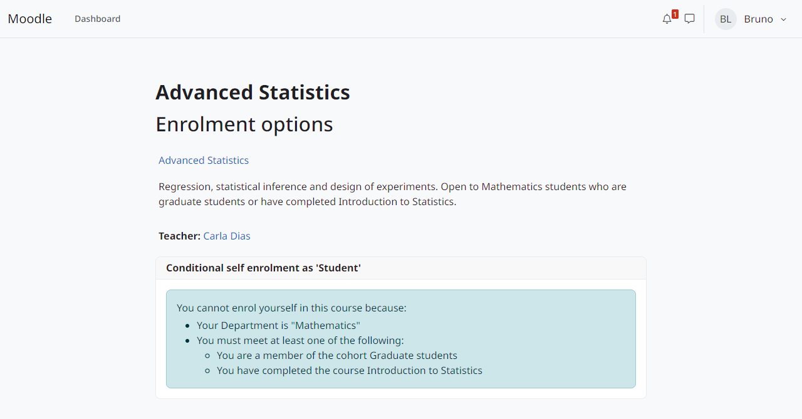
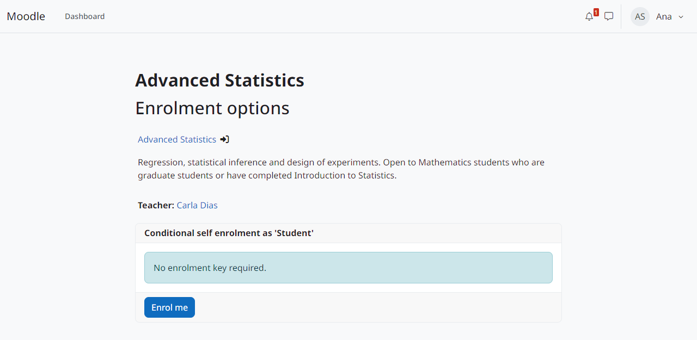

Uso
===

Adicionando o método a um curso
-------------------------------

#. No curso, acesse *Participantes > Métodos de inscrição* e adicione *Conditional self enrolment*.
#. Preencha as configurações usuais da autoinscrição (chave de inscrição, período, máximo de usuários...).
#. Em *Conditions*, monte as condições (veja abaixo).
#. Escolha quando as condições são reavaliadas e o que acontece quando um inscrito deixa de cumpri-las (veja :doc:`rechecks`).
#. Salve. Quem cumpre as condições vê o botão *Inscreva-me* na página do curso.

   Métodos de inscrição de um curso com *Conditional self enrolment*.

O editor de condições
---------------------

As condições formam uma árvore cuja raiz é um grupo:

* *Add condition* abre o formulário do *Condition type* escolhido.
* *Add group* cria um grupo dentro do atual, até a profundidade máxima.
* *How to combine the items of this group*: *All of these* (E) ou *Any of these* (OU).
* *Must not be met* inverte uma condição ou um grupo (NÃO).
* *Edit* e *Remove* alteram ou excluem um item.

   Departamento é Mathematics E (membro de uma coorte OU concluiu outro curso) E um período de datas.

Sem condições, qualquer pessoa que possa se autoinscrever no curso consegue se inscrever, como no ``enrol_self``. O editor precisa de JavaScript; sem ele, as condições salvas ficam como estão.

   *Add condition* abre o formulário do tipo escolhido.

O que o usuário vê
------------------

Quem cumpre as condições se inscreve como no ``enrol_self``. Quem não cumpre vê *You cannot enrol yourself in this course because:* seguido das condições não cumpridas, por exemplo "You have completed the course Introdução" ou "You must meet at least one of the following:".

   Quem não cumpre as condições.

   Quem cumpre as condições.

Quando uma condição não pode ser avaliada (tipo de condição desabilitado, arquivo perdido, consulta com erro), o resultado dela é *desconhecido*. Resultado desconhecido bloqueia novas autoinscrições (*A condition can no longer be checked. Contact the course teacher.*), mas nunca suspende, remove nem reativa uma inscrição existente.

Web service
-----------

O web service de autoinscrição do método (``enrol_conditional_enrol_user``) avalia as mesmas condições.
